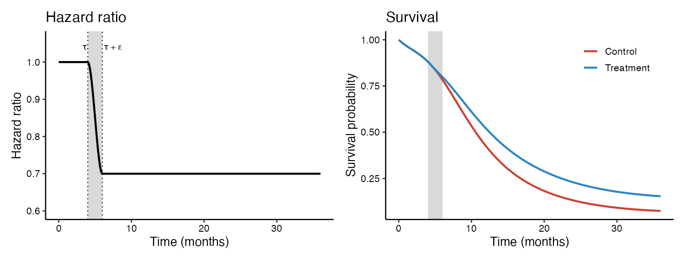
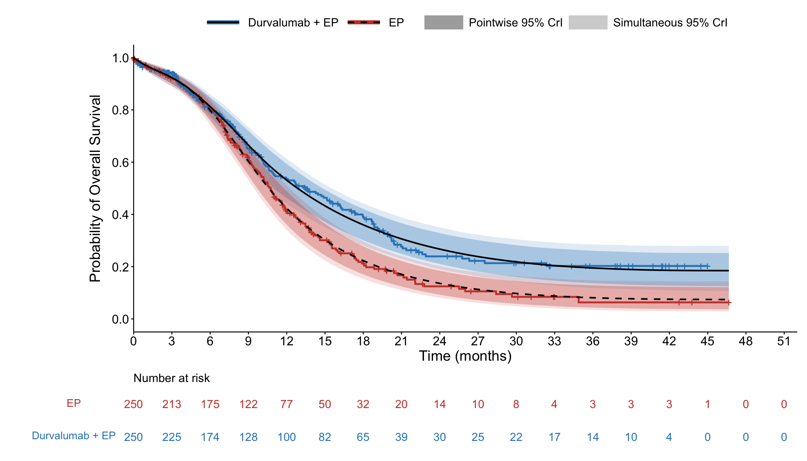

# BayesDTE

This repository contains the code to fit BayesDTE on survival data. 
BayesDTE is a Bayesian method for the analysis of clinical trials with a delayed 
treatment effect that takes into account the delay through the structure of the hazard ratio.

## Model

The baseline (control) cumulative hazard is modeled with an I-spline, so the baseline 
hazard is the corresponding M-spline. The spline coefficients are constrained to be 
positive and are given an AR(1) multivariate normal prior on the log scale to induce smoothness.

The hazard ratio between the treatment and control arms is

- 1 for $t \le \tau$ (no treatment effect during the delay),
- a cubic polynomial for $\tau < t \le \tau + \epsilon$ that moves smoothly from 1 to $e^{\beta}$,
- $e^{\beta}$ for $t > \tau + \epsilon$ (the post-delay hazard ratio).

Here $\tau$ is the length of the delay, $\epsilon$ is the length of the transition window, 
and $\beta$ is the log of the post-delay hazard ratio. The treatment-arm cumulative hazard 
is computed with Gaussian quadrature, and the model also returns the difference in 
restricted mean survival time (RMST) up to a chosen time `t_upper`.



*Hazard ratio and true survival curves with τ = 4, ε = 2, and a post-delay hazard 
ratio of 0.7. The grey region is the transition window.*

## Files

The Stan and R code for BayesDTE is found in the folder `Stan-R`. Note that 
`dte_pp.stan` and `dte_funs.stan` are coded to work with cmdstanr; it is recommended 
that you use these files for fitting BayesDTE.

- `dte_pp.stan`: the BayesDTE model, with the optional power prior.
- `dte_funs.stan`: Stan functions for the hazard ratio, cumulative hazards, and RMST.
- `dte_wrappers_pp.R`: R wrappers `get.standata.dte` (builds the Stan data) and `bayes_dte.mcmc` (fits the model).
- `rmst_funs.R`: R versions of the survival, hazard, and RMST functions for known parameter values.
- `generate_data.R`: `generate_data` simulates survival times from the BayesDTE model.
- `RMST_Cox.R`: RMST difference from a Cox model, with bootstrap intervals, for comparison.

We have also implemented the power prior within BayesDTE to allow for the incorporation
of historical data, although this development was not discussed in the paper and
has not yet been studied. If no historical data are provided in the function
`bayes_dte.mcmc`, the function will use the priors as discussed in the paper.

## Function options

The main arguments of `bayes_dte.mcmc` are listed below. Any other arguments 
(e.g. `chains`, `iter_warmup`, `iter_sampling`, `init`) are passed onto `cmdstanr`'s `$sample()`.

| Argument | Description |
|---|---|
| `t`, `delta`, `z` | Observed times, event indicators (1 = event), and treatment indicators (1 = treatment). |
| `knots` | Interior knots of the baseline spline, e.g. quantiles of the control-arm event times. |
| `n_nodes` | Number of Gaussian quadrature nodes. |
| `t_upper` | Upper limit of integration for the RMST. |
| `prior_tau` | Prior on $\tau$: `"uniform"` (default), `"mixture"` (a point mass at $\tau = 0$ mixed with a uniform), or `"half-normal"`. |
| `tau_max` | Upper limit of the uniform prior on $\tau$; defaults to the largest of the observed times and `t_upper`. |
| `mixture_weight` | Prior probability of $\tau = 0$ when `prior_tau = "mixture"` (default 0.5). |
| `sigma_tau` | Standard deviation of the half-normal prior when `prior_tau = "half-normal"` (default 1). |
| `tau_val`, `epsilon_val` | Fix $\tau$ or $\epsilon$ at a value instead of estimating it. |
| `sd_epsilon` | Standard deviation of the half-normal prior on $\epsilon$ (default 10). |
| `sd_beta`, `rho` | Standard deviation and AR(1) correlation of the prior on the log spline coefficients (defaults 10 and 0). |
| `sd_beta_trt` | Standard deviation of the normal prior on $\beta$ (default 10). |
| `t_hist`, `delta_hist`, `z_hist` | Historical data for the power prior (optional). |
| `a0` | Power prior discounting parameter in [0, 1]; `a0 = 0` (default) ignores the historical data. |

The output is a `cmdstanr` fit. Key quantities include `hr_post` ($e^{\beta}$), `tau`, `epsilon`, 
`rmst_ctrl_val`, `rmst_trt_val`, and `rmst_diff`. When `prior_tau = "mixture"`, `prob_null` 
gives the posterior probability that $\tau = 0$ for each draw, and `rmst_diff_mix` gives the 
RMST difference that accounts for the mixture.

## How to use this repository

1. Install R, [CmdStan](https://mc-stan.org/cmdstanr/), and the R packages `cmdstanr`, 
   `posterior`, `statmod`, and `splines2`. The example also uses `survival`, `survminer`, 
   `ggplot2`, `dplyr`, `patchwork`, and `ggtext`.
2. Set the working directory to the top level of this repository, since the files are 
   sourced with relative paths (e.g. `Stan-R/dte_wrappers_pp.R`).
3. Source the wrappers, which compile the Stan model the first time they are run:

   ```r
   source("Stan-R/dte_wrappers_pp.R")
   ```

4. Fit the model:

   ```r
   fit <- bayes_dte.mcmc(t, delta, z, knots = knots, n_nodes = 20, t_upper = 36,
                         prior_tau = "uniform", tau_max = 12,
                         chains = 4, parallel_chains = 4)
   fit$summary(c("hr_post", "tau", "rmst_diff"))
   ```

## Example

An example model fit is included in the folder `Example`. In the file `dte_example.R`, 
data are first generated using BayesDTE. There are no historical data in this example.
BayesDTE is then fit on the generated data, and the model fit is visualized by 
overlaying the posterior means of the survival curves, with pointwise and simultaneous 
95% credible bands, on top of the Kaplan-Meier curves.


